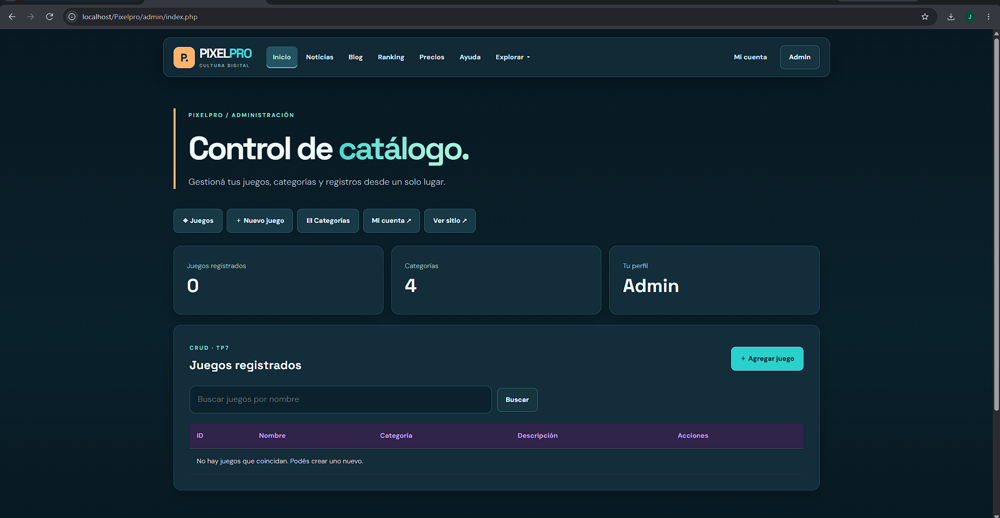
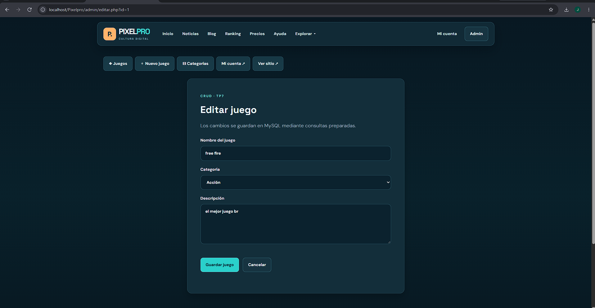
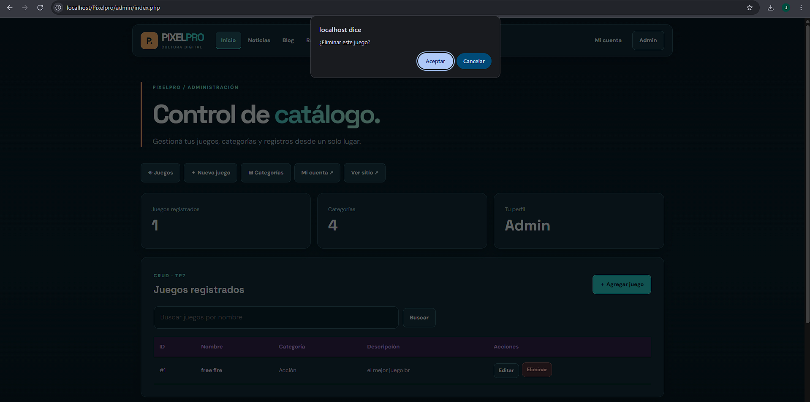

 PixelPro — TP7

**Instalación previa:** colocar `PixelPro/` en `C:\xampp\htdocs\`, encender Apache y MySQL, importar `PixelPro/database/schema.sql` en phpMyAdmin y configurar `PixelPro/config/.env` a partir de `.env.example` sin compartir las credenciales. Abrir `http://localhost/PixelPro/`.

## Objetivo

Implementar operaciones CRUD sobre MySQL utilizando PDO y consultas preparadas.

## Implementación

El CRUD administra la tabla **`juegos`**, con categoría asociada mediante `categorias_juego`:

- **Create:** `admin/crear.php` agrega juegos.
- **Read:** `admin/index.php` lista y permite buscar juegos mediante GET.
- **Update:** `admin/editar.php?id=...` cambia un juego existente.
- **Delete:** `admin/eliminar.php` recibe POST y verifica el token CSRF antes de eliminar.
- `admin/categorias.php`: alta y consulta de categorías.
- `config/conexion.php`: conexión PDO.

## Evidencias fotográficas 

### Listado de juegos

### Crear un juego

### Editar un juego

### Eliminar un juego

